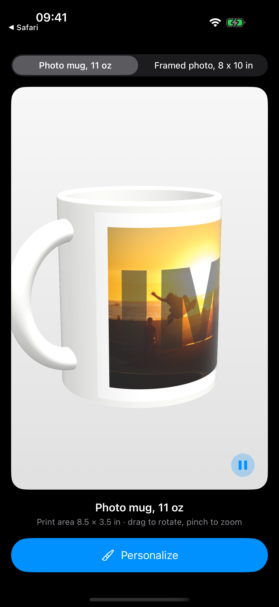
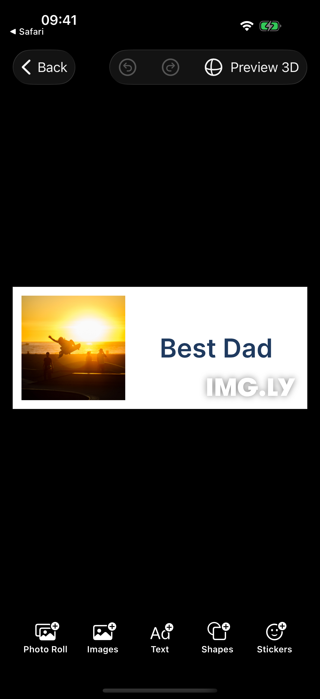
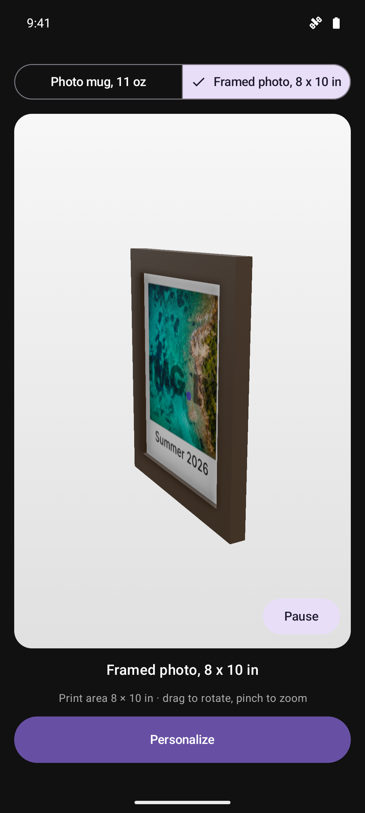

# 3D product preview with CE.SDK (iOS + Android)

An example application: the user personalizes a product (a photo mug, a framed photo) in the CE.SDK
Design Editor and sees the design on a 3D model that they can turn 360°, zoom and auto-rotate.

CE.SDK has no 3D renderer. CE.SDK renders the flat print design; a native 3D viewer puts that image
onto the product model as a texture. The same approach works for any product with a UV-mapped print area.

  

Screen recordings: [docs/media/ios-mug-rotate.mp4](docs/media/ios-mug-rotate.mp4), [docs/media/android-mug-rotate.mp4](docs/media/android-mug-rotate.mp4).

| | iOS | Android |
|---|---|---|
| Editor | CE.SDK `IMGLYEditor` 1.86.2 (Swift Package Manager) | CE.SDK `ly.img:editor` 1.86.2 (Maven) |
| Editor configuration | Design Editor starter kit v1.86.2 (MIT), adapted | Design Editor starter kit v1.86.2 (MIT), adapted |
| 3D viewer | SceneKit | SceneView 4.69.5 (Filament 1.77.3) |
| Model format | OBJ + MTL | GLB (glTF 2.0) |
| UI | SwiftUI, iOS 16+ | Jetpack Compose, Android 7+ (API 24) |

## How it works

1. **Build the page.** The editor opens one page that is exactly the product's print area
   (for the mug 8.5 × 3.5 in). The default design comes from `product.json`.
   iOS: [`ProductScene.swift`](ios/ProductPreview/ProductScene.swift) · Android: [`ProductScene.kt`](android/app/src/main/kotlin/ly/img/poc/productpreview/ProductScene.kt)
2. **Export a PNG.** "3D" (iOS) / "Preview 3D" (Android) runs the editor's export handler: the page is
   exported as PNG at `previewTextureWidthPx` and the editor closes.
   iOS: [`ProductEditorConfiguration.swift`](ios/ProductPreview/StarterKit/ProductEditorConfiguration.swift) · Android: [`OnExport.kt`](android/app/src/main/kotlin/ly/img/poc/productpreview/editor/callback/OnExport.kt)
3. **Bind the texture.** The 3D viewer finds the material named `print_area` in the model and sets the
   PNG as its base color texture.
   iOS: [`ProductSceneView.swift`](ios/ProductPreview/ProductSceneView.swift) · Android: [`ProductViewer.kt`](android/app/src/main/kotlin/ly/img/poc/productpreview/ProductViewer.kt)
4. **Keep the scene.** The CE.SDK scene string is kept, so "Personalize" opens the same design again.

On first launch each product's default template is rendered once without UI (headless engine), so the
model is not blank.

## Build and run

You need network access: the editor loads its asset library and the template photos from the IMG.LY CDN.

**CE.SDK license.** Without a key the editor runs in evaluation mode and puts an "IMG.LY" watermark on the
design (and on the 3D texture). Both key files are git-ignored:
- iOS: put the key in `ios/ProductPreview/cesdk-license.txt`, then run `xcodegen generate` again.
- Android: add `CESDK_LICENSE=<key>` to `android/local.properties`.

### iOS

Prerequisites: Xcode 27.2 (iOS 26 SDK), [XcodeGen](https://github.com/yonaskolb/XcodeGen) (`brew install xcodegen`).

```bash
cd ios
xcodegen generate
open ProductPreview.xcodeproj
```

Run the `ProductPreview` scheme on a simulator. The project has code signing turned off
(`CODE_SIGNING_ALLOWED: NO` in `project.yml`). To run on a device, pass your own team at build time,
for example:

```bash
xcodebuild -project ProductPreview.xcodeproj -scheme ProductPreview -destination 'id=<device-udid>' -allowProvisioningUpdates DEVELOPMENT_TEAM=<your-team-id> CODE_SIGNING_ALLOWED=YES build
```

### Android

Prerequisites: JDK 21, Android SDK with platform 37 (set `ANDROID_HOME`, or `sdk.dir` in
`android/local.properties`).

```bash
cd android
./gradlew :app:installDebug
```

The build copies `../products` into the app assets (task `syncProductAssets`), so both apps use the same
product files. The debug APK is about 240 MB because it contains the CE.SDK engine for all four ABIs; a
release build split per ABI is much smaller.

## The product definition (`product.json`)

Each product is one folder in [`products/`](products) with a `product.json` and the model files.
This is the data a backend delivers per product. Both apps load every folder that has a `product.json`.

| Field | Unit | Used by | Meaning |
|---|---|---|---|
| `id` | – | both | Unique product id. |
| `order` | – | both | Position in the product picker (ascending). |
| `name` | – | both | Display name. |
| `model.glb` | file name | Android | glTF 2.0 binary model, relative to the product folder. |
| `model.obj` | file name | iOS | OBJ model (with its `.mtl`), relative to the product folder. |
| `model.printMaterial` | – | both | Name of the material that gets the design texture. |
| `model.uvLayout` | – | – | Human-readable note on the UV layout (not read by the apps). |
| `printArea.widthInch`, `heightInch` | inch | both | Size of the print area = size of the CE.SDK page. |
| `printArea.dpi` | dots per inch | both | Scene resolution for print export. |
| `printArea.previewTextureWidthPx` | px | both | Width of the PNG used as 3D texture; height follows the aspect ratio. |
| `template.backgroundColor` | hex `#RRGGBB` | both | Page background. |
| `template.image.uri` | URL | both | Default photo. |
| `template.image.frameInch` | inch | both | Photo frame `x`, `y`, `width`, `height` on the page (origin top left). |
| `template.text.value` | – | both | Default text. |
| `template.text.frameInch` | inch | both | Text frame on the page; the height grows with the text. |
| `template.text.colorHex` | hex `#RRGGBB` | both | Text color. |
| `template.text.fontSizePt` | pt | both | Font size. |
| `viewer.cameraDistanceM` | m | both | Camera distance from the model's center. |
| `viewer.targetYM` | m | both | Height of the point the camera orbits around. |
| `viewer.initialYawDeg` | degree | both | Start rotation of the model around the vertical axis. |
| `viewer.autoRotateDegPerSec` | degree/s | both | Auto-rotate speed. |

**UV rule.** The `print_area` material's UVs cover the range [0, 1] × [0, 1], and that range is the full
CE.SDK page: u = 0 is the left page edge, u = 1 the right edge; v = 0 the top edge, v = 1 the bottom edge
(glTF convention; the OBJ stores v flipped, as OBJ expects). Seen from outside, u grows to the right.
On the mug, u starts next to the handle and runs once around the mug (302° of 360°; the gap is at the handle).
Model units are meters.

### Add a product

1. Make a folder `products/<name>/` with a `product.json` (copy one and change it).
2. Add the model: a GLB for Android and an OBJ + MTL for iOS. The material that takes the print must be
   named like `model.printMaterial`, and its UVs must follow the UV rule above.
   For a simple shape you can extend [`tools/gen_models.py`](tools/gen_models.py) (pure Python, no dependencies).
3. Set `order`, then build again. iOS bundles the `products` folder; Android copies it at build time.

## What this PoC simplifies

- **Watermark:** without a license key the design and the 3D texture carry the "IMG.LY" evaluation watermark.
- **Models:** the mug and frame are simple generated shapes (`tools/gen_models.py`), no bevels or PBR texture
  maps. A product line uses its own GLB/USDZ models with the same material name and UV rule.
- **Designs in memory only:** edits are lost when the app closes. A production app stores the scene string per
  user and product (and the print-resolution export) on its backend.
- **Template built in code:** the default design is built from `product.json`. A production app ships a CE.SDK
  `.scene` file or scene archive per product.
- **Update on tap:** the 3D model updates when the user taps "3D" / "Preview 3D", not live while editing.
- **CDN assets:** template photos and the editor's asset library load from the IMG.LY CDN, which is for
  development only. Production self-hosts the assets.
- **Portrait only**, and **not tested** on real devices for photo upload from Photo Roll / Gallery.

## Model source and licenses

- The 3D models are generated by [`tools/gen_models.py`](tools/gen_models.py) in this repository. They use no
  third-party assets.
- The editor configuration is adapted from the CE.SDK Design Editor starter kits (MIT):
  [`ios/LICENSE-starterkit.txt`](ios/LICENSE-starterkit.txt), [`android/LICENSE-starterkit.txt`](android/LICENSE-starterkit.txt).
- CE.SDK itself needs a license for production use.
